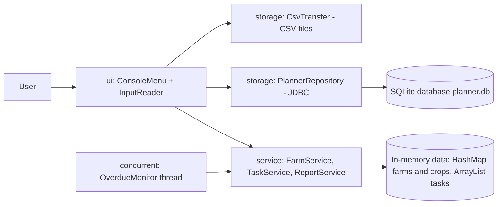
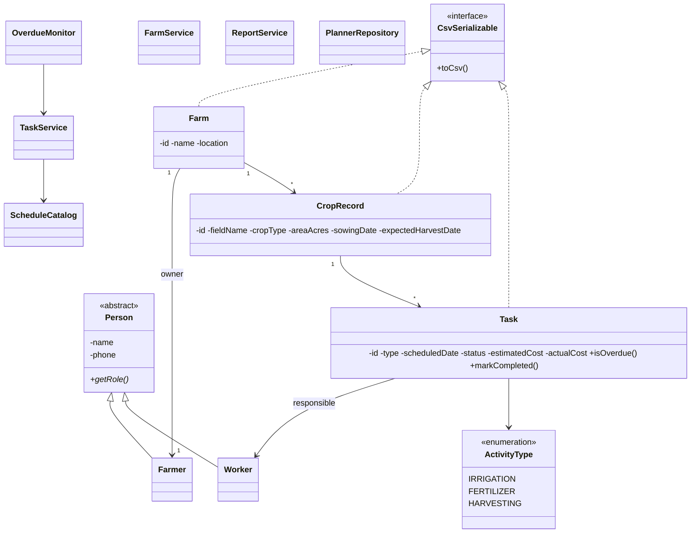
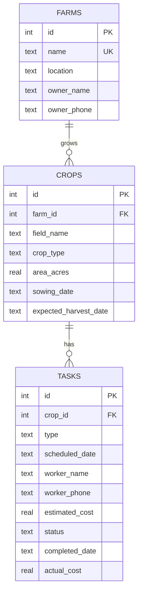

# Design

## Layers and data flow

1. At start-up `PlannerRepository.load()` reads every table with `ResultSet` and fills `PlannerData`.
2. Business rules and reports work on the in-memory collections (Streams, Comparators).
3. After every change the menu writes it to the database with a `PreparedStatement` inside a transaction.
4. `OverdueMonitor` is a daemon thread that recounts overdue tasks every few seconds.

## Class diagram

## Database design

Dates are stored as ISO text (`yyyy-MM-dd`). Foreign keys, a unique farm name, `area_acres > 0` and
`status IN ('PENDING','COMPLETED')` are enforced by the database itself.

## Key design decisions
| Decision | Reason |
|---|---|
| Collections in memory, JDBC for persistence | Reports and rules stay simple with Streams/Comparators and can be unit tested without a database |
| `Person` abstract class with `Farmer` and `Worker` | Shared validation (name, 10-digit phone) with a role-specific `getRole()` |
| `CsvStore<T extends CsvSerializable>` | One generic reader/writer instead of three copies |
| Transactions for multi-row writes | A generated schedule or a CSV import is saved completely or not at all |
| `TaskService` methods are `synchronized` | The monitor thread reads the task list while the user changes it |
| Daemon monitor thread | Tasks become overdue with the passing of time, not only after user actions |
| Cost matrix uses a `double[][]` | Fixed table of fields x activity types with row and column totals |
